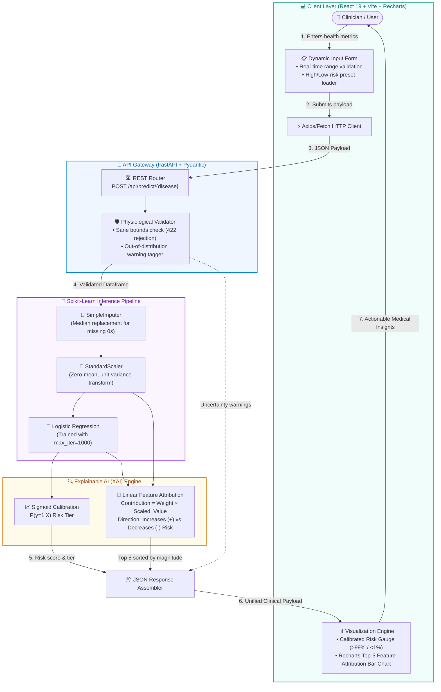

<div align="center">

# 🩺 AI-Based Disease Risk Prediction Dashboard

### A modern, explainable clinical decision-support web application for multi-disease risk assessment.

<p align="center">
  
  
  
  
  
  
  
</p>

</div>

> 🛡️ **Educational demo only. Not a medical diagnosis.**

---

<div align="center">
  
</div>

---

## 🌟 Overview

The **AI-Based Disease Risk Prediction Dashboard** provides an interactive clinical decision-support interface for assessing patient risk across two major clinical conditions: **Type 2 Diabetes** and **Breast Cancer**. The application couples Scikit-learn pipelines with a high-performance FastAPI backend and a responsive React frontend, delivering evaluated risk probabilities and transparent feature attribution breakdowns. By computing standardized regression coefficient contributions, each prediction is paired with a visual explanation illustrating which physiological markers increase or reduce disease likelihood.

---

## ✨ Key Features

- 🎯 **Multi-Disease Screening:** Instantly switch between Type 2 Diabetes (Pima Indians) and Wisconsin Diagnostic Breast Cancer risk models.
- 📋 **Dynamic Validated Form:** Dynamically rendered input fields featuring unit labels, training range hints, and real-time client-side validation against biological sane limits.
- ⚡ **Preset Patient Profiles:** Quick one-click loaders for verified test-set high-risk and low-risk patient cases.
- 📈 **Calibrated Risk Tiers:** Evaluates risk probability categorized into distinct tiers (Low &lt;33%, Moderate 33–66%, High &gt;66%) with probability clamping (`>99%` or `<1%`) to avoid unrealistic 100% or 0% certainty indications.
- 🔍 **Explainable AI (XAI) Attribution:** Recharts horizontal bar chart detailing the top 5 factors influencing the score (red for risk drivers, green for protective effects).
- ⚠️ **Out-of-Range Warnings:** Informational notices flag inputs that fall outside training distribution limits while remaining physiologically possible.
- 📊 **Model Performance & Benchmarks:** Dedicated evaluation tab presenting holdout test metrics, 2×2 diagnostic confusion matrices, and 50-run repeated stratified cross-validation comparisons (Baseline vs. Logistic Regression vs. Random Forest).
- 🗄️ **Interactive Dataset Explorer:** In-app inspection card displaying dataset provenance, record counts, feature sets, and class balance.
- 🧪 **Automated Test Suite:** Comprehensive Pytest test suite covering endpoints, schema validation, risk monotonicity, and error handling.

---

## 📸 Interface Gallery

<table>
  <tr>
    <td width="50%">
      
      <p align="center"><b>Default Dashboard View</b><br/>Input form with clinical defaults and initial prompt state.</p>
    </td>
    <td width="50%">
      
      <p align="center"><b>Diabetes High-Risk Assessment</b><br/>High-risk prediction with risk gauge, badges, and factor drivers.</p>
    </td>
  </tr>
  <tr>
    <td width="50%">
      
      <p align="center"><b>Diabetes Low-Risk Assessment</b><br/>Low-risk outcome displaying protective feature contributions.</p>
    </td>
    <td width="50%">
      
      <p align="center"><b>Breast Cancer Assessment</b><br/>Evaluated malignancy risk with clamped probability display.</p>
    </td>
  </tr>
  <tr>
    <td width="50%">
      
      <p align="center"><b>Model Performance Tab</b><br/>Holdout metrics cards, cross-validation table, and 2×2 confusion matrix.</p>
    </td>
    <td width="50%">
      
      <p align="center"><b>Dataset Information Panel</b><br/>Provenance, record counts, and clinical class distribution.</p>
    </td>
  </tr>
</table>

---

## 🏗️ System Architecture & How It Works



---

## 🔬 Datasets & Provenance

| Disease | Dataset | Source | Records | Features | Target |
| :--- | :--- | :--- | :---: | :---: | :--- |
| **Diabetes** | [Pima Indians Diabetes](https://www.openml.org/search?type=data&id=37) | National Institute of Diabetes and Digestive and Kidney Diseases via OpenML | 768 | 8 | Diabetes diagnosis (1 = diabetic, 0 = non-diabetic) |
| **Breast Cancer** | [Breast Cancer Wisconsin (Diagnostic)](https://archive.ics.uci.edu/dataset/17/breast+cancer+wisconsin+diagnostic) | UCI Machine Learning Repository via Scikit-learn | 569 | 10 | Tumor malignancy status (1 = malignant, 0 = benign) |

*Preprocessing note:* In the Diabetes dataset, biologically impossible zeros in Glucose, BloodPressure, SkinThickness, Insulin, and BMI were treated as missing values and imputed using training median values; in Breast Cancer, only the 10 core mean nuclear morphology attributes were extracted and the target was calibrated so 1 represents malignant.

---

## 📊 Empirical Model Results

Empirical metrics computed from direct pipeline training:

### 1. Holdout Test Performance (80/20 Stratified Split)

| Disease | Accuracy | Precision | Recall (Sensitivity) | F1-Score | ROC-AUC | Confusion Matrix `[TN, FP / FN, TP]` |
| :--- | :---: | :---: | :---: | :---: | :---: | :---: |
| **Diabetes** | 70.78% | 60.00% | 50.00% | 0.5455 | 0.8130 | `[82, 18 / 27, 27]` |
| **Breast Cancer** | 92.98% | 88.64% | 92.86% | 0.9070 | 0.9841 | `[67, 5 / 3, 39]` |

### 2. Repeated Stratified Cross-Validation (5 Folds × 10 Repeats = 50 Runs)

| Disease | Model Candidate | Mean Accuracy | Mean F1-Score | Mean ROC-AUC |
| :--- | :--- | :---: | :---: | :---: |
| **Diabetes** | Baseline (Majority Class) | 65.10% ± 0.20% | 0.000 ± 0.000 | 0.500 ± 0.000 |
| | **Logistic Regression (Deployed)** | **76.70% ± 2.90%** | **0.624 ± 0.054** | **0.835 ± 0.028** |
| | Random Forest (200 trees) | 76.50% ± 2.50% | 0.641 ± 0.042 | 0.829 ± 0.027 |
| **Breast Cancer** | Baseline (Majority Class) | 62.70% ± 0.40% | 0.000 ± 0.000 | 0.500 ± 0.000 |
| | **Logistic Regression (Deployed)** | **93.70% ± 2.00%** | **0.912 ± 0.029** | **0.985 ± 0.006** |
| | Random Forest (200 trees) | 93.70% ± 2.40% | 0.915 ± 0.033 | 0.983 ± 0.009 |

*Model Note:* While Breast Cancer detection achieves high sensitivity (92.86%), Diabetes recall is modest (50.00%), reflecting the inherent non-linear overlap of clinical attributes in the Pima cohort and underscoring the necessity of secondary laboratory panels.

---

## 🛠️ Technology Stack

| Layer | Technology | Purpose |
| :--- | :--- | :--- |
| **Backend Framework** | [FastAPI](https://fastapi.tiangolo.com/) + [Uvicorn](https://www.uvicorn.org/) | High-performance asynchronous REST API with Swagger documentation |
| **Package Management** | [uv](https://docs.astral.sh/uv/) (Astral) | Blazing-fast deterministic Python environment resolution |
| **Machine Learning** | [Scikit-learn](https://scikit-learn.org/), [NumPy](https://numpy.org/), [Pandas](https://pandas.pydata.org/), [Joblib](https://joblib.readthedocs.io/) | Imputation, standardization, modeling, cross-validation & serialization |
| **Validation & Testing** | [Pydantic](https://docs.pydantic.dev/), [Pytest](https://docs.pytest.org/), [HTTPX](https://www.python-httpx.org/) | Strict schema type enforcement and automated regression testing |
| **Frontend Framework** | [React 19](https://react.dev/) + [Vite](https://vitejs.dev/) | Component-driven UI with instant HMR and development proxy |
| **Data Visualization** | [Recharts](https://recharts.org/) | Responsive SVG bar charts for Explainable AI feature attribution |
| **Icons & Typography** | [Lucide React](https://lucide.dev/), [Inter](https://fonts.google.com/specimen/Inter) | Clean iconography and accessible clinical typography |

---

## 📁 Project Directory Structure

```
healthrisk-dashboard/
├── backend/
│   ├── app/
│   │   ├── __init__.py
│   │   ├── main.py
│   │   ├── schemas.py
│   │   └── train.py
│   ├── models/
│   │   ├── breast_cancer.joblib
│   │   ├── breast_cancer_metrics.json
│   │   ├── diabetes.joblib
│   │   └── diabetes_metrics.json
│   ├── tests/
│   │   ├── conftest.py
│   │   └── test_api.py
│   ├── pyproject.toml
│   └── uv.lock
├── frontend/
│   ├── src/
│   │   ├── App.jsx
│   │   ├── index.css
│   │   └── main.jsx
│   ├── index.html
│   ├── package-lock.json
│   ├── package.json
│   └── vite.config.js
├── docs/
│   └── screenshots/
│       ├── 01-dashboard-empty.png
│       ├── 02-diabetes-high-risk.png
│       ├── 03-diabetes-low-risk.png
│       ├── 04-breast-cancer-result.png
│       ├── 05-model-performance.png
│       └── 06-about-the-data.png
├── .gitignore
└── README.md
```

---

## 🔌 REST API Reference

| Method | Endpoint | Description |
| :--- | :--- | :--- |
| `GET` | `/api/health` | Service health check returning operational status and available model list. |
| `GET` | `/api/diseases` | Retrieves supported diseases, field schemas (units, limits, defaults), and sample patient profiles. |
| `GET` | `/api/metrics/{disease}` | Returns holdout metrics, cross-validation benchmarks, and dataset summary for the given disease. |
| `POST` | `/api/predict/{disease}` | Validates physiological inputs, evaluates risk probability, and returns top 5 contributing factors with warnings. |

---

## 🚀 Getting Started

### Prerequisites

- **Python 3.11+**
- **uv** package manager (`curl -LsSf https://astral.sh/uv/install.sh` or `pip install uv`)
- **Node.js 18+** & **npm**

### Step 1: Start the Backend

```bash
cd backend
uv sync
uv run python -m app.train
uv run pytest -v
uv run uvicorn app.main:app --port 8000
```
Backend API will be running at `http://localhost:8000` (interactive documentation available at `http://localhost:8000/docs`).

### Step 2: Start the Frontend

Open a new terminal session:
```bash
cd frontend
npm install
npm run dev
```
Frontend application will be accessible at `http://localhost:5173`.

---

## ⚠️ Limitations & Clinical Caution

1. **Small Reference Datasets:** The Pima Diabetes ($N=768$) and Wisconsin Diagnostic Breast Cancer ($N=569$) cohorts are benchmark reference datasets that may not represent broad global populations.
2. **Not Clinically Validated:** This application is developed for educational exploration. It has not undergone formal clinical trial evaluation and must not supersede certified healthcare practitioners.
3. **Modest Diabetes Recall:** Diabetes recall on holdout testing is 50.00%, meaning borderline at-risk patients require further diagnostic screening (such as HbA1c panels).
4. **Descriptive Associations:** Model predictions describe statistical patterns identified in retrospective cohorts rather than definitive medical diagnoses.

---

## 👨‍💻 Author

<table style="border: none;">
  <tr>
    <td width="90" align="center" style="border: none;">
      <a href="https://github.com/ahmadaquib">
        
      </a>
    </td>
    <td style="border: none;">
      <h3 style="margin-top: 0; margin-bottom: 4px;">Aquib</h3>
      <p style="margin: 0; color: #64748b; font-size: 0.95rem;">
        MLOps &amp; AI Systems Engineer &bull; Building explainable, high-reliability healthcare AI applications.
      </p>
      <p style="margin-top: 8px; margin-bottom: 0;">
        <a href="https://github.com/ahmadaquib">
          
        </a>
      </p>
    </td>
  </tr>
</table>
