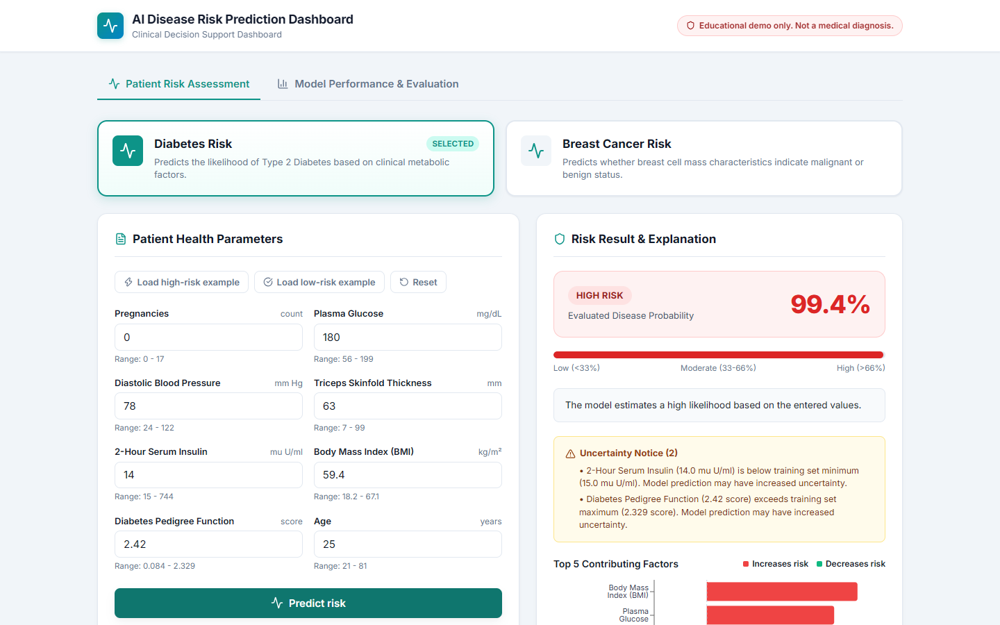
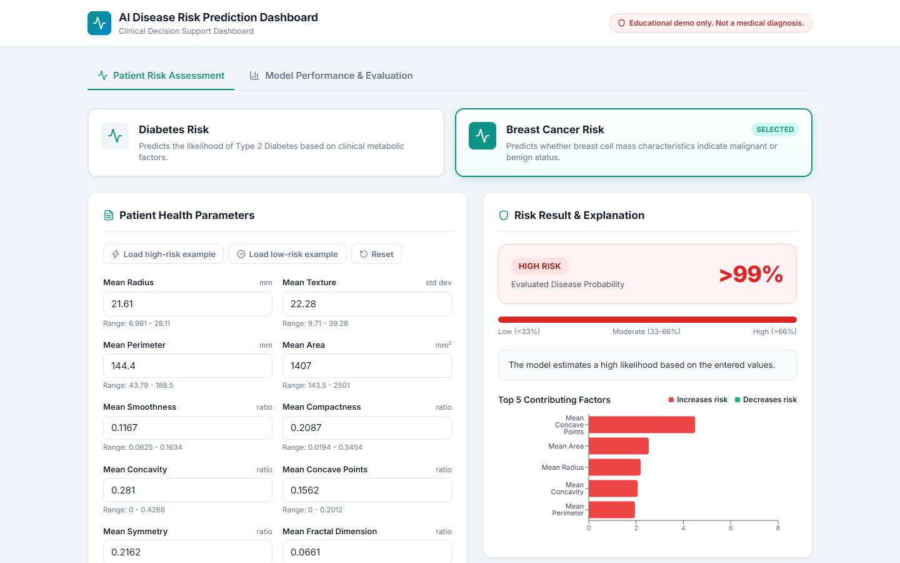
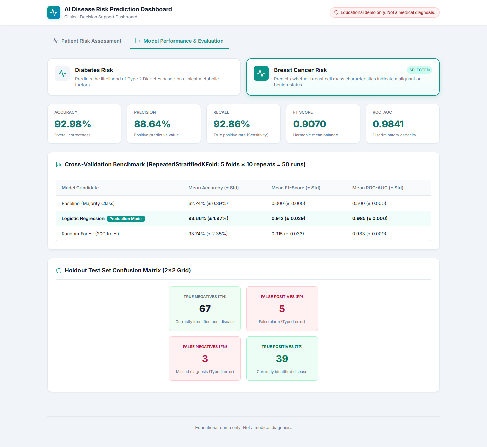
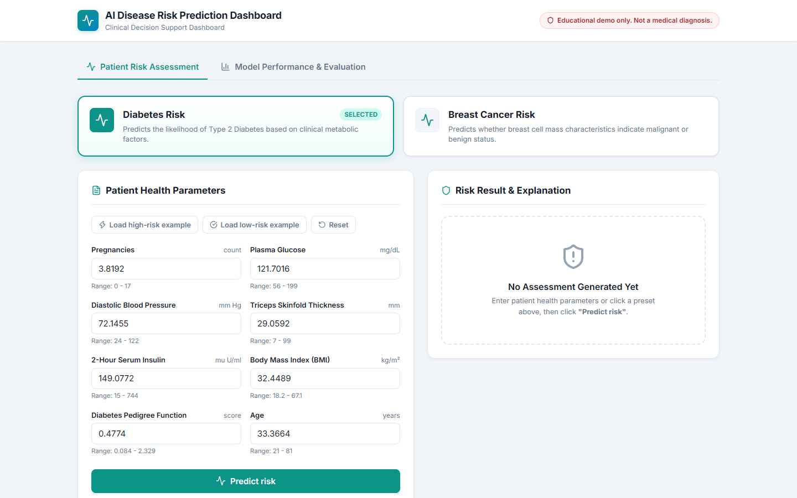
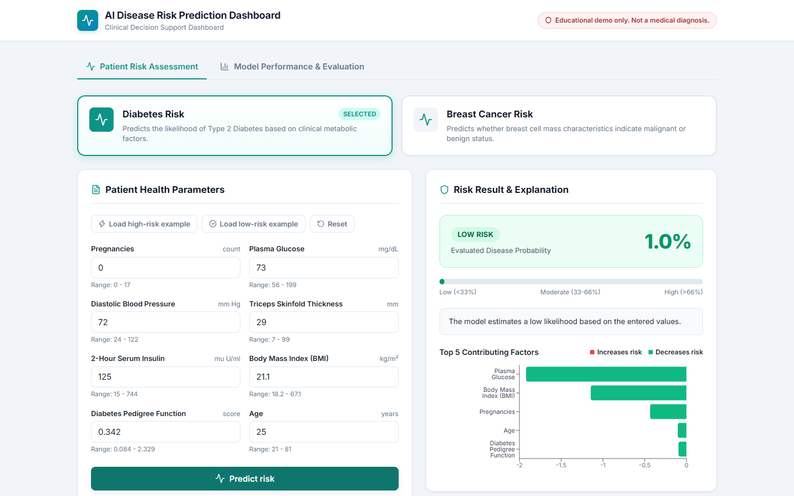
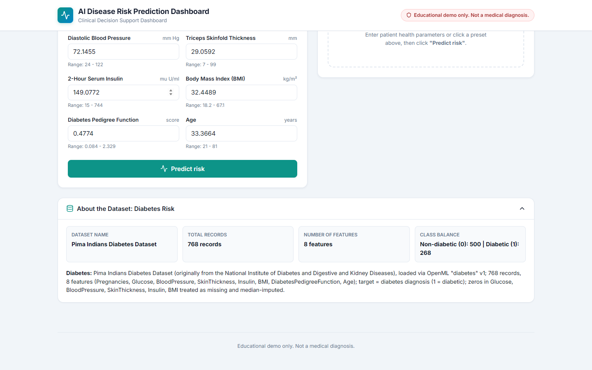
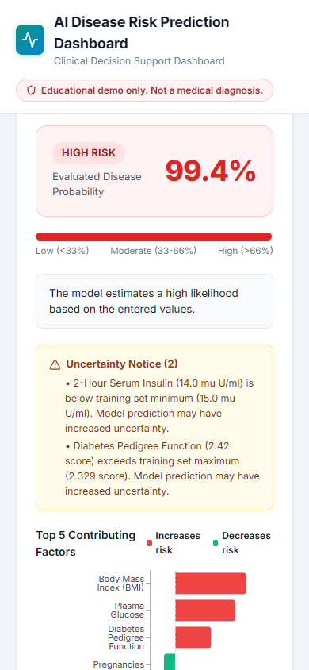

# AI-Based Disease Risk Prediction Dashboard

Enter patient health values, get a disease risk estimate and see which factors drove it.

   

> Educational demo only. Not a medical diagnosis.



## What it does

- Predicts risk for Diabetes and Breast Cancer
- Shows a risk percentage with Low / Moderate / High level
- Explains each prediction with the top 5 contributing factors
- Compares Logistic Regression against a baseline and Random Forest

## Screenshots

<table>
  <tr>
    <td width="50%">
      
      <p align="center">Breast cancer prediction with top contributing factors</p>
    </td>
    <td width="50%">
      
      <p align="center">Model evaluation metrics and cross-validation benchmark</p>
    </td>
  </tr>
</table>

<details>
<summary>More screenshots</summary>






</details>

## Results

| Disease | Dataset size | Accuracy | Recall | ROC-AUC |
| :--- | :---: | :---: | :---: | :---: |
| **Diabetes** | 768 | 76.7% | 50.0% | 0.835 |
| **Breast Cancer** | 569 | 93.7% | 92.9% | 0.985 |

Diabetes recall is modest, which is typical for this small dataset.

## Datasets

| Disease | Dataset | Records | Features |
| :--- | :--- | :---: | :---: |
| **Diabetes** | [Pima Indians Diabetes](https://www.openml.org/search?type=data&id=37) | 768 | 8 |
| **Breast Cancer** | [Breast Cancer Wisconsin (Diagnostic)](https://archive.ics.uci.edu/dataset/17/breast+cancer+wisconsin+diagnostic) | 569 | 10 |

Preprocessing: median imputation, standardization, zeros treated as missing for diabetes.

## Run it

Backend:
```bash
cd backend
uv sync
uv run python -m app.train
uv run uvicorn app.main:app --port 8000
```

Frontend (new terminal):
```bash
cd frontend
npm install
npm run dev
```

Open http://localhost:5173

Run tests with: `uv run pytest -v` (from `backend/`).

## Limitations

- Small datasets
- Not clinically validated
- Outputs show patterns in the data, not real diagnoses

Built by [Aquib](https://github.com/ahmadaquib).
